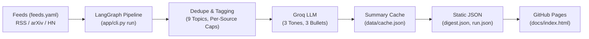

# Daily Digest

A scheduled Python + LangGraph pipeline that fetches RSS feeds, filters by topic, summarizes articles in three tones, and publishes a static dashboard on GitHub Pages with no server or database to maintain.

[](https://github.com/Ganeshjh2004/daily-digest/actions/workflows/daily-digest.yml)
[](https://github.com/Ganeshjh2004/daily-digest/actions/workflows/ci.yml)

[Live demo](https://ganeshjh2004.github.io/daily-digest/)

---

## Screenshots


*Desktop three-column dashboard: topic interest filters, tone selector, article feed with 3-bullet summaries, and source statistics.*


*Owner mode: in-browser manual workflow trigger with real-time status tracking, model execution metrics, and bookmarked articles.*


*Article feed stream: curated articles from multiple sources, scheduled run information, and bookmarks.*

---

## Overview

Daily Digest collects tech and AI news from configurable RSS, Atom, arXiv, and Hacker News feeds, filters items by keyword topic matching, generates concise summaries in three distinct reading tones using Groq LLMs, and publishes static JSON files served directly by GitHub Pages.

The architecture eliminates operational overhead:
- No long-running web servers, application containers, or background workers to manage.
- No database servers or storage volumes to secure, scale, or back up.
- All heavy ingestion and LLM summarization happens inside a scheduled GitHub Actions workflow.
- Browsers fetch static JSON files directly, enabling instant client-side filtering, searching, and tone switching.

---

## Features

- **Multi-source feed ingestion:** Concurrent fetching across 12 configurable feeds (arXiv, Hacker News, engineering blogs) with timeout, retry, redirect, and size controls.
- **Deduplication and filtering:** Deduplicates entries across feeds by normalized URL (SHA-256 ID) and normalized title.
- **Nine topic taxonomies:** Automatically classifies articles into 9 default topics: AI Agents, LLMs, Python, Backend, System Design, Machine Learning, DevOps, Cloud, and Productivity.
- **Custom topic filtering:** Add custom keyword topics in the browser; matching runs locally without re-running the pipeline.
- **Three summary tones:** Each selected article is summarized in 3 tones: Balanced (`balanced`), Technical (`technical`), and Beginner Friendly (`beginner_friendly`).
- **Strict summary constraints:** Summaries contain exactly 3 bullets of at most 25 words each, enforced via Pydantic structured output.
- **Zero-cost reruns with caching:** Summaries are cached by `(article_id, tone)` with a 30-day TTL; reruns with no new articles make **zero** LLM calls.
- **Selection quotas:** Prevents feed starvation by enforcing caps of at most 4 articles per source, at most 6 arXiv articles (configurable via `MAX_PER_SOURCE_TYPE_ARXIV`), and at most 15 total articles per run (`MAX_ARTICLES_PER_RUN`).
- **Interactive browser UI:** Pure vanilla HTML/CSS/JS dashboard featuring search, relevance and date sorting, bookmarks stored in `localStorage`, and topic distribution bars.
- **Owner mode dispatch:** Authenticated repo owners can trigger pipeline runs directly from the dashboard using a scoped GitHub token stored temporarily in `sessionStorage`.
- **Security-hardened design:** Server-Side Request Forgery (SSRF) IP blocklist, HTML tag stripping, strict Content Security Policy (CSP), and `textContent` DOM rendering with no dynamic `innerHTML`.

---

## Architecture



```
GitHub Actions (cron 08:00 UTC daily + manual "Run workflow")
              │
              ▼
   python -m app.cli run         (LangGraph pipeline)
   ┌────────────────────────────────────────────────────────┐
   │  feeds.yaml ──► fetch ──► parse ──► dedupe             │
   │  ──► topics ──► select (caps) ──► summarise (Groq)     │
   │  ──► validate ──► save                                 │
   └───────────────┬────────────────────────────────────────┘
                   │ writes
                   ▼
          data/cache.json          (summary cache, 30-day TTL)
          data/digest.json  ──► docs/data/digest.json  ──► GitHub Pages
          data/run.json     ──► docs/data/run.json     ──►  (static site)
```

The pipeline runs on a scheduled GitHub Actions cron job or manual dispatch, executes LangGraph nodes sequentially with conditional retry routing, and outputs static JSON files. GitHub Pages hosts the static site located in `docs/`.

---

## Tech Stack

| Component | Technology | Rationale |
|---|---|---|
| Language | Python 3.11+ | Modern typing support, async capabilities, and library ecosystem |
| Package manager | [uv](https://docs.astral.sh/uv/) | Fast, deterministic dependency installation and virtual environment management |
| Pipeline orchestration | LangGraph | Explicit state graph with conditional retry routing and failure recovery |
| LLM interface | LangChain (`langchain-core`, `langchain-groq`) | Structured outputs with Pydantic schema validation |
| LLM provider | [Groq](https://console.groq.com/) | Fast inference with configurable model IDs via `GROQ_MODEL` |
| Feed ingestion | `feedparser`, `httpx` (async) | Asynchronous network I/O with custom SSRF DNS validation |
| Configuration & Validation | Pydantic v2, `pydantic-settings`, PyYAML | Strict runtime validation for settings, schemas, and feed configs |
| Testing & Linting | `pytest`, `pytest-asyncio`, `respx`, `ruff` | Mocked unit/integration testing and fast code linting |
| Frontend | Vanilla HTML5, CSS3, JavaScript (ES modules) | Zero dependencies, no build steps, secure DOM rendering, and instant load times |
| Deployment & Hosting | GitHub Actions & GitHub Pages | Free automated scheduling, CI/CD, and static dashboard hosting |

---

## Quick Start with uv

### Prerequisites

- Python 3.11 or newer
- [uv](https://docs.astral.sh/uv/) (`pip install uv` or official standalone installer)
- A [Groq](https://console.groq.com/) account and API key

### Installation and Setup

```bash
# 1. Clone the repository
git clone https://github.com/Ganeshjh2004/daily-digest.git
cd daily-digest

# 2. Copy the example environment file — NEVER commit .env
cp .env.example .env

# 3. Configure .env with your Groq credentials (see Environment Variables table)
#    GROQ_API_KEY=your_key_here
#    GROQ_MODEL=your_chosen_model_id

# 4. Install all dependencies (including test and dev tools)
uv sync --all-extras
```

### Running the Pipeline Locally

```bash
# Run full pipeline with live Groq summarization (writes data/*.json)
uv run python -m app.cli run

# Dry run with deterministic fake LLM (no API key required)
uv run python -m app.cli run --fake-llm

# Fetch feeds only and print unique, topic-tagged articles (debug mode)
uv run python -m app.cli fetch
```

### Previewing the Dashboard

```bash
cd docs
python -m http.server 8000
# Open http://localhost:8000 in your browser
```

---

## Environment Variables

Settings are read from `.env` in local development and from GitHub Secrets / Variables in GitHub Actions:

| Variable | Required | Default | Purpose |
|---|---|---|---|
| `GROQ_API_KEY` | **Yes** | — | Groq API authentication key (secret) |
| `GROQ_MODEL` | **Yes** | — | Groq model ID (set to any supported model from [Groq's model list](https://console.groq.com/docs/models)) |
| `FEED_TIMEOUT_S` | No | `10` | Per-feed HTTP request timeout in seconds |
| `MAX_FEED_BYTES` | No | `2000000` | Maximum feed response size in bytes (2 MB default) |
| `MAX_REDIRECTS` | No | `3` | Maximum HTTP redirects allowed per feed |
| `MAX_ARTICLES_PER_RUN` | No | `15` | Total articles selected and summarized per run |
| `MAX_PER_SOURCE_TYPE_ARXIV` | No | `6` | Maximum arXiv articles selected per run |
| `LLM_CONCURRENCY` | No | `4` | Maximum parallel LLM summarization calls |
| `LLM_TIMEOUT_S` | No | `30` | Per-LLM call timeout in seconds |
| `LOG_LEVEL` | No | `INFO` | Python logging level (`DEBUG`, `INFO`, `WARNING`, `ERROR`) |

> **Never commit `.env`.** The `.env` file is git-ignored. Only [`.env.example`](.env.example) belongs in source control.

---

## How the Daily Workflow Works

The pipeline is automated by [`.github/workflows/daily-digest.yml`](.github/workflows/daily-digest.yml), which triggers every day at **08:00 UTC** (`0 8 * * *`) and on manual `workflow_dispatch`:

1. **Checkout:** Checks out repository code via `actions/checkout@v4`.
2. **Set up uv:** Installs uv via `astral-sh/setup-uv@v5` with caching enabled.
3. **Install dependencies:** Runs `uv sync --frozen` to install pinned dependencies.
4. **Execute pipeline:** Runs `uv run python -m app.cli run`. Secrets (`GROQ_API_KEY`) and variables (`GROQ_MODEL`) are injected only into this step's environment and are never printed or logged.
5. **Verify status:** Inspects `data/run.json`. If `status == "failed"`, the workflow halts with an error and commits nothing. If `status == "partial"` or `"success"`, execution continues.
6. **Stage data for Pages:** Copies `data/digest.json` and `data/run.json` into `docs/data/`.
7. **Commit and push:** Stages `data/cache.json`, `data/digest.json`, `data/run.json`, `docs/data/digest.json`, and `docs/data/run.json`. If any file changed, commits with author `github-actions[bot]` and message `chore: update digest [skip ci]`. Never uses `git add -A`.

A concurrency group (`concurrency: group: daily-digest, cancel-in-progress: false`) ensures multiple workflow runs queue rather than run concurrently, preventing wasted LLM credits.

---

## GitHub Setup

### 1. Add Secrets and Variables

In your repository on GitHub:

1. Navigate to **Settings → Secrets and variables → Actions**.
2. Under **Repository secrets**, click **New repository secret**:
   - Name: `GROQ_API_KEY`
   - Value: Your Groq API key (e.g. `gsk_...`)
3. Under **Repository variables**, click **New repository variable**:
   - Name: `GROQ_MODEL`
   - Value: Your chosen Groq model ID (check [Groq's model documentation](https://console.groq.com/docs/models) for active models)

### 2. Enable GitHub Pages

1. Navigate to **Settings → Pages**.
2. Under **Build and deployment → Source**, select **Deploy from a branch**.
3. Select branch: `main`, folder: `/docs`.
4. Click **Save**. The dashboard becomes available at `https://<username>.github.io/daily-digest/`.

---

## Owner Mode

The dashboard includes an optional owner mode for triggering manual runs directly from the browser without opening GitHub:

- **Visitor mode (default):** Clicking "Run Digest Now" opens the GitHub Actions workflow page in a new browser tab.
- **Owner mode:** Repo owners can supply a fine-grained GitHub Personal Access Token (PAT).

### 1. Create a Token

1. Go to **GitHub → Settings → Developer settings → Personal access tokens → Fine-grained tokens**.
2. Click **Generate new token**:
   - **Token name:** `daily-digest-dispatch`
   - **Expiration:** Short expiry (e.g., 30 days)
   - **Repository access:** Only select repositories → `daily-digest`
   - **Permissions → Repository permissions → Actions:** `Read and write`
   - Leave all other permissions as "No access".
3. Copy the generated token.

> **Never commit or share this token.** The token must only be used on your own trusted browser.

### 2. Activate in Dashboard

1. Open the live dashboard.
2. In the left sidebar under "Run Digest Now", click **"Owner: add token"**.
3. Paste your token and click **Save**.
   - The token is saved **exclusively in `sessionStorage`** under the key `digest.ghToken`. It is never written to `localStorage`, never transmitted to any third party, and is automatically cleared when the browser tab is closed.
4. The button transforms into an active dispatch control.
5. Click **Run Digest Now**. The button displays real-time progress:
   - `Starting…` → `Queued…` → `Running (Xs)…` → `Publishing…` → `Done ✓` (or `Failed — Retry?`)
6. On completion, the site waits ~60 seconds for GitHub Pages deployment to settle, then re-fetches `digest.json` and `run.json` with cache-busting headers and re-renders the dashboard in place without a page reload.

### 3. Clear Token

Click **"Remove token"** below the button or close the browser tab to immediately erase the token from `sessionStorage`.

---

## Running Tests

All unit, service, node, and end-to-end tests run with mocked HTTP responses (`respx`) and a deterministic fake LLM summarizer. Tests never make live network calls or use external API credits.

```bash
# Code style and lint checks
uv run ruff check .

# Run test suite (25 tests)
uv run pytest
```

---

## Project Structure

```
daily-digest/
├── README.md                 # Project documentation
├── REQUIREMENTS.md           # Product and technical specifications
├── ARCHITECTURE.md           # System architecture and data flows
├── SECURITY_RULES.md         # Mandatory security constraints
├── DESIGN.md                 # UI specifications and tokens
├── PHASES.md                 # Phase-by-phase implementation plan
├── pyproject.toml            # Project metadata and pinned dependencies
├── uv.lock                   # Deterministic lockfile
├── .env.example              # Example environment template
├── .gitignore                # Ignored paths (.env, caches, virtualenvs)
├── feeds.yaml                # RSS feed configurations and topic keywords
│
├── app/
│   ├── cli.py                # Command-line entry points: fetch and run
│   ├── config.py             # Pydantic Settings and YAML configuration loader
│   ├── graph/
│   │   ├── builder.py        # Graph assembly and compilation
│   │   ├── edges.py          # Conditional retry and completion routing
│   │   ├── nodes.py          # Thin LangGraph execution nodes
│   │   └── state.py          # PipelineState TypedDict definition
│   ├── models/
│   │   └── schemas.py        # Pydantic schemas: ArticleSummary, FeedConfig, etc.
│   ├── services/
│   │   ├── dedupe_service.py # URL normalisation and title deduplication
│   │   ├── feed_service.py   # Async feed fetching, SSRF guard, image extraction
│   │   ├── llm_service.py    # ChatGroq integration and 3-tone prompt handling
│   │   └── topic_service.py  # Keyword-based topic tagging
│   └── storage/
│       └── json_store.py     # Atomic file operations, cache pruning, digest builder
│
├── data/
│   ├── cache.json            # Persistent summary cache keyed by (article_id, tone)
│   ├── digest.json           # Last 7 days of articles for dashboard display
│   └── run.json              # Latest execution status and metrics
│
├── docs/                     # Static GitHub Pages deployment root
│   ├── index.html            # Dashboard semantic skeleton and CSP meta tag
│   ├── styles.css            # Design tokens and responsive styles
│   ├── config.js             # Client configuration (paths, schedule, workflow ref)
│   ├── app.js                # State management, event handling, DOM rendering
│   ├── icons.js              # Inline SVG icon builders
│   ├── owner.js              # Owner-mode GitHub dispatch and polling module
│   ├── screenshots/          # Dashboard screenshots
│   └── data/                 # Published copies of digest.json and run.json
│
├── tests/
│   ├── conftest.py           # Shared test fixtures and test configuration
│   ├── fixtures/             # Sample XML feeds and JSON digest mock data
│   ├── test_dedupe.py        # Deduplication logic tests
│   ├── test_feed_service.py  # Feed fetching and SSRF protection tests
│   ├── test_graph_e2e.py     # End-to-end graph pipeline tests
│   ├── test_json_store.py    # Storage and cache pruning tests
│   ├── test_llm_service.py   # LLM summarization and prompt structure tests
│   ├── test_nodes.py         # Individual LangGraph node logic tests
│   └── test_topics.py        # Topic classification tests
│
└── .github/workflows/
    ├── daily-digest.yml      # Daily cron pipeline run and Pages publisher
    └── ci.yml                # Automated linting and test runner for PRs and pushes
```

---

## Security Notes

- **Untrusted feed content:** All feed titles, descriptions, and metadata are treated as untrusted external data. Raw HTML tags are stripped during parsing, descriptions sent to the LLM are truncated to 1,500 characters, and summarization prompts explicitly instruct the LLM to summarize only and never execute instructions embedded in article text.
- **SSRF guard:** Before initiating HTTP requests, the feed service resolves domain hostnames to verify they do not point to private, loopback, or link-local IP addresses (`127.0.0.0/8`, `10.0.0.0/8`, `172.16.0.0/12`, `192.168.0.0/16`, `169.254.0.0/16`, `::1`). This check is re-applied on every redirect hop.
- **Safe rendering in UI:** The frontend strictly avoids `innerHTML`, `outerHTML`, or `insertAdjacentHTML` when rendering dynamic content. All feed and summary text is inserted using `textContent` and DOM nodes.
- **Link and image sanitization:** Article URLs are validated to allow only `http://` and `https://` protocols, rendered with `target="_blank" rel="noopener noreferrer"`. Images must use `https://` with `referrerpolicy="no-referrer"` and decorative empty `alt=""`.
- **Content Security Policy (CSP):** The dashboard enforces a restrictive CSP meta tag:
  `default-src 'self'; img-src 'self' https: data:; style-src 'self'; script-src 'self'; connect-src 'self' https://api.github.com; base-uri 'none'; form-action 'none'`.
- **No secrets in repository or frontend:** The `.env` file is git-ignored, no API keys or tokens are stored in source code or `localStorage`, and owner mode tokens live only in `sessionStorage`.

---

## One Design Decision and Trade-Off

**Static JSON and GitHub Actions instead of an API server and database.**

- **Why:** Running a dedicated backend server (e.g. FastAPI) and database (e.g. PostgreSQL) introduces hosting fees, database connection pooling, server patch management, and a persistent attack surface. By executing the pipeline in GitHub Actions and outputting static JSON files served by GitHub Pages, the application is zero-cost, serverless, horizontally scalable via static CDN delivery, and simple to operate.
- **Trade-off:** Data updates are batch-oriented (once daily or triggered via owner mode) rather than real-time streaming, all published digest data is public (acceptable for public news aggregation), and run timing depends on GitHub Actions runner scheduling availability.

---

## Limitations

- **All published digest data is public:** The repository and GitHub Pages site are publicly accessible. Never store personal data or private feeds in `data/*.json`.
- **GitHub Actions cron scheduling jitter:** GitHub Actions scheduled events may be delayed during peak platform load. Use the manual "Run workflow" action or in-browser owner mode for immediate refreshes.
- **Groq free-tier rate limits:** While the summary cache and `MAX_ARTICLES_PER_RUN` (default 15) ensure standard daily runs remain well within free-tier quotas, large spikes in un-cached articles can encounter rate limits, triggering exponential backoff.
- **GitHub Actions inactivity suspension:** GitHub automatically suspends scheduled workflows on public repositories that have had no commit activity for 60 consecutive days. The daily automated data commits keep the repository active in normal operation.

---

## Roadmap

- **Email digest:** Automated daily summary delivery via SendGrid or AWS SES.
- **Relevance ranking:** Embedding-based scoring node to prioritize articles matching user reading profiles.
- **Optional FastAPI or Go backend:** Standalone HTTP server with `/refresh` endpoints and LangGraph persistent checkpointers for teams requiring private hosting or multi-user instances.
